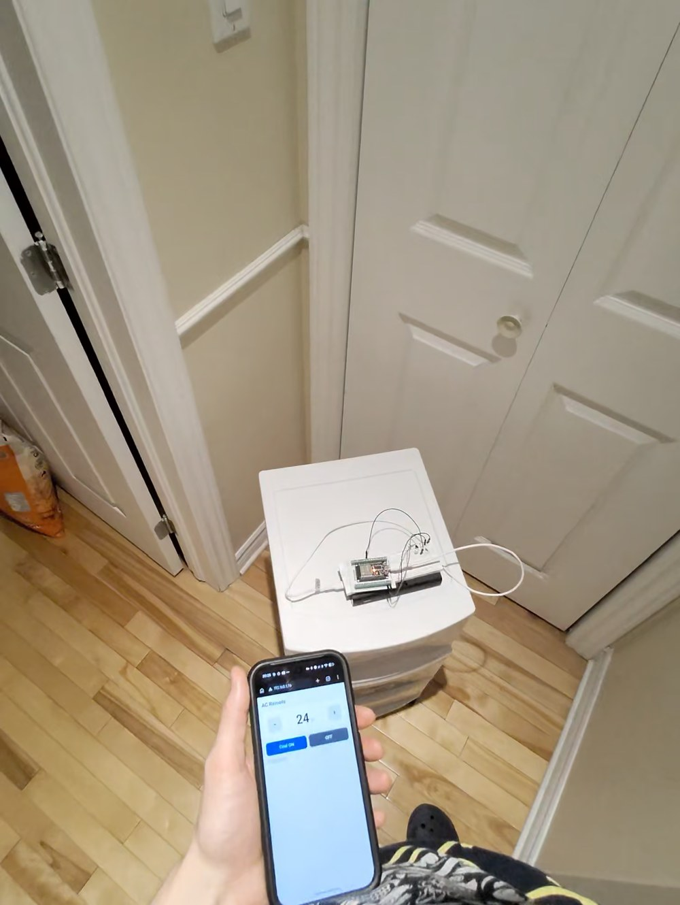

# IR AC Remote Controller

Control a Fujitsu split air conditioner from your phone, using an ESP32 and an IR LED. The ESP32 sends the same infrared commands as the original remote.

<!-- DEMO VIDEO: drag the video file here in GitHub's web editor. -->



## How it works

The ESP32 joins your Wi-Fi network and serves a small phone page with a temperature setting and **Cool ON** / **OFF** buttons. When you tap a button, it builds a full Fujitsu AC state frame (power, mode, temperature, fan) with the [IRremoteESP8266](https://github.com/crankyoldgit/IRremoteESP8266) library. It then sends that frame through a transistor-driven 940 nm IR LED.

It was tested on a Fujitsu `ASU9C1` indoor unit, which uses the `ARDB1` remote protocol. Other Fujitsu units that use an `ARDB1`-style remote may work too.

## Parts list

| Qty | Part | Notes |
|---|---|---|
| 1 | ESP32 dev board (ESP-WROOM-32, 30-pin DevKit) | Any ESP32 board with GPIO18 and a 5 V (VIN) pin |
| 1 | 5 mm 940 nm IR LED | |
| 1 | 2N2222A NPN transistor | Low-side switch for the LED |
| 1 | 1 kΩ resistor | Transistor base |
| 1 | 100 Ω resistor | LED current limit (from 5 V) |
| 1 | Breadboard + jumper wires | |
| 1 | USB power (5 V): phone charger or power bank | |

## Wiring

Full description: [`docs/wiring.md`](docs/wiring.md).

| From | To |
|---|---|
| ESP32 GPIO18 (D18) | 1 kΩ resistor → transistor **base** |
| Transistor **emitter** | GND |
| Transistor **collector** | IR LED **cathode** (short leg) |
| IR LED **anode** (long leg) | 100 Ω resistor → ESP32 **VIN** (5 V) |
| ESP32 GND | GND rail |

Never drive the IR LED directly from a GPIO pin. The transistor lets the LED run from 5 V at a useful current.

## Build and flash

You need [arduino-cli](https://arduino.github.io/arduino-cli/) or the Arduino IDE. Install the ESP32 core and the IRremoteESP8266 library (tested with 2.9.0):

```sh
arduino-cli core install esp32:esp32
arduino-cli lib install IRremoteESP8266
```

1. Create your config:

   ```sh
   cp firmware/ac_remote/config.example.h firmware/ac_remote/config.h
   ```

   In `config.h`, set:
   - your Wi-Fi name and password (2.4 GHz network);
   - the fallback access point password.

   `config.h` is git-ignored.

2. Compile and upload. Use 115200 baud: the default upload speed failed on the board used here.

   ```sh
   arduino-cli compile --fqbn esp32:esp32:esp32 firmware/ac_remote
   arduino-cli upload -p <serial-port> --fqbn esp32:esp32:esp32 \
     --upload-property upload.speed=115200 firmware/ac_remote
   ```

   Find `<serial-port>` with `arduino-cli board list`. If the upload stalls, hold the board's `BOOT` button while it says "Connecting".

3. Open a serial monitor at 115200 baud. The board prints its IP address.

If the ESP32 has no `config.h`, or can't join your Wi-Fi, it starts its own access point instead. Its name and password come from `AP_SSID` and `AP_PASSWORD`, and the page is at `http://192.168.4.1/`.

## How to use

1. Put the ESP32 where the IR LED has a clear line of sight to the AC's receiver window. In the demo, the AC is across the room.
2. On a phone on the same Wi-Fi network, open `http://esp32-ac.local/` (or the board's IP).
3. Set the temperature with **−** / **+** and tap **Cool ON**, or tap **OFF**.

The page shows the last state the ESP32 *sent*. The AC can't report back over IR, so check the unit itself; it beeps when it accepts a command.

### HTTP endpoints

All endpoints use `GET` and return JSON status:

| Endpoint | Action |
|---|---|
| `/` | Phone page |
| `/on` | Power on with the current settings |
| `/off` | Power off |
| `/cool?temp=24` | Power on in cool mode at 24 °C |
| `/set?power=on&mode=cool&temp=24&fan=auto` | Set the full state |
| `/status` | Current desired state, no IR send |

Accepted values:
- `mode`: `auto`, `cool`, `heat`, `dry`, `fan`;
- `fan`: `auto`, `high`, `medium`, `low`, `quiet`;
- `temp`: 16-30 °C.

Sends are rate-limited to one every 3 seconds; a faster send returns HTTP 429.

### Troubleshooting

- **The page stopped loading after a power cycle.** The board probably got a new IP address from your router. Try `http://esp32-ac.local/`, check the serial output, or set a DHCP reservation on your router.
- **The AC doesn't respond.** First aim the LED straight at the AC's receiver window, from closer. You can see whether the LED flashes with a phone camera; some phone cameras filter IR, so try the front camera.

## Security

The page and the endpoints have no login. Anyone on your network can turn the AC on or off. Only use it on a network you trust, and set your own `AP_PASSWORD`.

## Repository layout

```
firmware/ac_remote/   ESP32 firmware (Arduino) with the built-in phone page
docs/wiring.md        Parts list and wiring
docs/demo.mp4         Demo video
docs/images/          Photo of the setup
```

## License

MIT. See [LICENSE](LICENSE).
